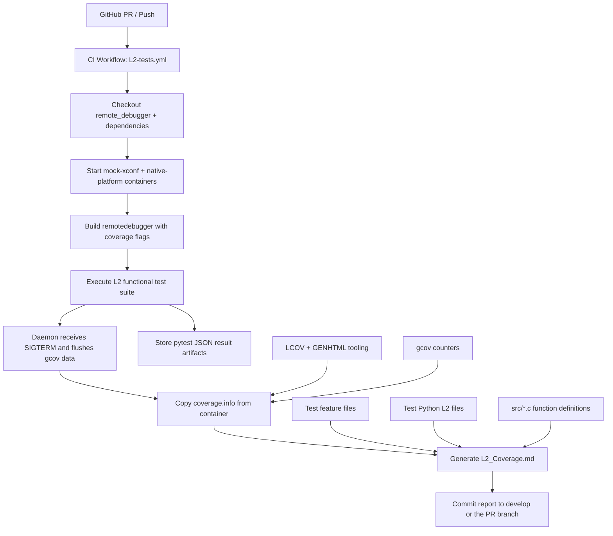

# Remote Debugger L2 Function Coverage - High-Level Design

## Document Information
- **Component Name:** Remote Debugger L2 Functional Coverage Automation
- **Version:** 1.1
- **Date:** October 23, 2026
- **Primary Scope:** Coverage collection for L2 functional tests, trace-file generation, and report synthesis for feature-to-test gap analysis
- **Target Environment:** Linux CI container and embedded-device test harness used by the Remote Debugger project

## 1. Executive Summary

This document describes the high-level design introduced for L2 functional coverage documentation in the Remote Debugger project. The change adds a reproducible path to build the daemon with coverage instrumentation, execute the L2 suite in a containerized environment, collect `gcov`/`lcov` data, and generate a Markdown coverage report that maps feature files to test cases and highlights coverage gaps.

The design supports the following objectives:

- Generate reliable coverage data for `remotedebugger` while L2 tests are executing.
- Ensure coverage counters are flushed on daemon termination so data is not lost.
- Reuse the existing functional-test framework without changing test behavior.
- Publish a human-readable L2 coverage summary that tracks which behaviors are covered and which remain untested.
- Provide a gap-analysis artifact that connects BDD feature files and Python L2 tests for future expansion.

This is a documentation and automation design rather than a new runtime feature for the daemon itself. It improves observability, traceability, and quality gate health for the functional test suite.

## 2. Goals and Scope

### 2.1 Goals

1. Enable coverage instrumentation for the L2 journey without impacting the core daemon logic.
2. Execute L2 tests in a CI-like container environment with a deterministic build path.
3. Collect `coverage.info` from the native-platform test container after the suite completes.
4. Parse test metadata and feature metadata to compute function-level and feature-level coverage signals.
5. Publish a generated Markdown report under the test-functional directory for review in PRs and CI.
6. Support incremental test improvement by identifying orphan features, orphan tests, and unmapped scenarios.

### 2.2 Non-Goals

- Replacing the existing functional-test suite or altering product behavior.
- Measuring unit-test coverage in the same workflow as L2 coverage.
- Enforcing a single mandatory coverage threshold across all product areas.
- Modifying business logic in the daemon for testability reasons alone.

## 3. Architecture Overview

### 3.1 System Context



### 3.2 High-Level Components

The design is built around four primary components:

1. **Coverage-enabled build path**
   - Rebuilds the daemon with `-DUSECOV` and `--coverage` in both `CFLAGS` and `LDFLAGS`.
   - Uses the existing `cov_build.sh` workflow and `run_l2.sh` execution path.

2. **Runtime coverage flush**
   - Installs a signal handler in `rrdMain.c` for `SIGTERM`.
   - Calls `__gcov_dump()` before exiting so counters are written before the process terminates.
   - `kill_rrd()` in the test helpers sends `SIGTERM` instead of `SIGKILL` when `RRD_COVERAGE_MODE` is set, so the handler runs.

3. **L2 execution and collection pipeline**
   - Runs the functional tests in the native-platform container.
   - `run_l2.sh` captures the lcov baseline before the tests and the merged, filtered `coverage.info` after them.
   - Copies `coverage.info` back to the runner after test completion.
   - Publishes test result artifacts for CI visibility.

4. **Coverage report synthesis**
   - Maps `*.feature` files to `*.py` L2 tests.
   - Parses `coverage.info` and compares the functions it recorded as called against every function defined in `src/*.c`.
   - Outputs a Markdown report with the L2 Test Summary, function coverage, feature-to-test mapping, gap analysis, and next actions.

## 4. Design Principles

- **Low intrusion:** The production logic is not changed beyond necessary instrumentation and signal handling.
- **Deterministic automation:** The report is generated in CI from the same build and test inputs each run.
- **Evidence-driven quality tracking:** The generated report serves as a living artifact rather than an isolated static document.
- **Traceability:** Feature files, L2 test files, and coverage data are linked in a single repository artifact.
- **Portability:** The approach relies on standard `gcov`/`lcov` tooling and containerized execution; it fits the project’s embedded Linux environment.

## 5. Detailed Module Breakdown

### 5.1 Coverage-enabled Build Configuration

**Module:** `cov_build.sh`

**Purpose:** Build the project with coverage instrumentation enabled when the L2 suite is executed.

**Responsibilities:**
- Pass `-DUSECOV` (and `-DUSE_L2_SUPPORT`) in `remotedebugger_CFLAGS`.
- Pass `--coverage` in both `remotedebugger_CFLAGS` and `remotedebugger_LDFLAGS`, so GCC instruments the code and links the gcov runtime.
- Leave `Makefile.am` and `configure.ac` unchanged; the flags are supplied on the `make` command line.

**Key design behavior:**
- Coverage is not enabled by default for every production build.
- The L2 flow specifically builds the daemon in the test container in a coverage mode so the report is meaningful and reproducible.
- `.gcno` files are written next to the objects under `src/`, and `.gcda` files appear there when the daemon exits.

**Dependencies:**
- GNU make
- `gcc`/`gcov`
- `lcov`
- project source tree and mock dependencies

### 5.2 Runtime Signal Handling for Coverage Flush

**Module:** `src/rrdMain.c`, `test/functional-tests/tests/helper_functions.py`, `run_l2.sh`

**Purpose:** Guarantee that `gcov` counters are flushed before the remote-debugger daemon exits under normal test shutdown.

**Key implementation detail:**

```c
#ifdef USECOV
#include <signal.h>
#include <stdlib.h>
extern void __gcov_dump(void);

static void rrd_gcov_sigterm_handler(int sig)
{
    (void)sig;
    __gcov_dump();
    _exit(0);
}
#endif
```

**Responsibilities:**
- Install the `SIGTERM` handler in `main()` (right after `rdk_logger_init`) when `USECOV` is enabled.
- Call `__gcov_dump()` to write the counter data.
- Exit immediately without leaving data pending in the runtime buffer.
- `run_l2.sh` exports `RRD_COVERAGE_MODE=1`; `kill_rrd()` then sends signal 15 in place of 9 when the tests stop the daemon.

**Why this matters:**
The daemon never returns from `main()`, and the tests kill it by signal. GCC's `atexit` flush does not run on a signal death, and `SIGKILL` cannot be caught. Without the handler and the signal change, the `.gcda` files would be empty and the report would show no coverage.

### 5.3 L2 Test Execution Pipeline

**Module:** `.github/workflows/L2-tests.yml`, `run_l2.sh`

**Purpose:** Execute the full functional suite in a consistent container environment and archive its artifacts.

**Responsibilities:**
- Start the dependent supporting services such as mock xConf.
- Check out source and dependent repositories into the container.
- Run the build and functional-test sequence.
- Push the pytest JSON results (`/tmp/l2_test_report`) to the RDK orchestration backend.
- Copy `coverage.info` back to the runner, generate the report, and commit it on pushes.

**Triggers and permissions:**
- Runs on `pull_request` and `push` to `develop`; the job has `contents: write` and the checkout uses `GITHUB_TOKEN` so `git push` is authenticated.
- The copy and generate steps run on both events. The commit step runs on `push`, and on pull requests whose head branch is in the same repository. Fork PRs are skipped because the token cannot push to a fork.
- On pull requests the checkout uses the PR head branch (`github.head_ref`) rather than the merge commit, so the bot commit lands on the PR branch.

**Data produced:**
- pytest JSON result files, one per test file (`--json-report-summary`)
- `coverage.info`
- generated Markdown report, committed back to `develop` on push

### 5.4 Trace Collection and Coverage Data

**Module:** `lcov`, `genhtml`, steps in `run_l2.sh`

**Purpose:** Capture and normalize the runtime coverage result into a single file used for reporting.

**Steps in `run_l2.sh` (all output under `/tmp/l2_coverage/`):**
1. `lcov --zerocounters` and `lcov --capture --initial` produce `coverage_base.info`. The baseline registers every instrumented function, including ones no test calls.
2. The pytest suites run.
3. `lcov --capture` produces `coverage_test.info` from the `.gcda` files written at shutdown.
4. `lcov --add-tracefile` merges the baseline and test files into `coverage_merged.info`.
5. `lcov --remove '/usr/*'` drops system and dependency headers and writes `coverage.info`.
6. `genhtml` builds a browsable report in `/tmp/l2_coverage/html`.

**Outputs:**
- `coverage.info`, the input to the report generator
- HTML coverage views in `/tmp/l2_coverage/html`

Branch data is still captured (`lcov_branch_coverage=1`) for the HTML report, but the Markdown report does not show it.

### 5.5 Coverage Report Generation

**Module:** `test/functional-tests/generate_l2_coverage_report.py`

**Purpose:** Convert the lcov trace, the source tree and the feature/test inventory into a human-readable summary and gap analysis.

**Responsibilities:**
- Scan `src/*.c` and collect the name of every function definition (brace-depth parse with comments and strings stripped; every `#if` branch counts).
- Read `coverage.info` and collect the functions whose `FNDA` call count is above zero.
- Discover feature files under `test/functional-tests/features/` and count scenarios.
- Discover Python L2 tests under `test/functional-tests/tests/` and count `def test_` functions; count commented-out and skip-marked tests as disabled.
- Map each feature to its test file by name (`test_` + feature stem), and flag orphan features, orphan tests and scenario-to-test gaps.
- Write `test/functional-tests/L2_Coverage.md`.

**Command line:**

```
python3 generate_l2_coverage_report.py \
    --tracefile    /tmp/coverage.info \
    --src-dir      src \
    --features-dir test/functional-tests/features \
    --tests-dir    test/functional-tests/tests \
    --output       test/functional-tests/L2_Coverage.md
```

**Generated report sections:**
1. Executive summary: the L2 Test Summary block and a metrics table
2. Feature-to-test mapping, with orphans and tests that exceed the scenario count
3. Per-module lines, functions and a coverage bar
4. Per-behavior coverage detail (static text)
5. Scenario-to-test gap analysis
6. Gap recommendations at P1, P2 and P3 (static text; their row counts feed the priority counts in the summary)
7. Test infrastructure notes
8. File inventory appendix

The behavior detail and recommendations are maintained by hand inside the script. Everything else is computed.

## 6. Functional Workflow

### 6.1 Build Flow

1. The workflow checks out the project and its dependent repositories.
2. The container starts mock services and the native-platform test environment.
3. `cov_build.sh` is executed with the project-specific CFLAGS and LDFLAGS, including `--coverage` and `-DUSECOV`.
4. The build includes instrumentation flags so the daemon produces runtime gcov data.

### 6.2 Test Flow

1. `run_l2.sh` exports `RRD_COVERAGE_MODE=1`, zeroes the counters and captures the lcov baseline.
2. `run_l2.sh` runs each pytest suite against the instrumented daemon.
3. At teardown `kill_rrd()` sends `SIGTERM` (not `SIGKILL`) because `RRD_COVERAGE_MODE` is set.
4. The daemon traps `SIGTERM` and calls `__gcov_dump()` before exiting.
5. `run_l2.sh` captures the test data, merges it with the baseline, filters `/usr/*`, and writes `/tmp/l2_coverage/coverage.info` plus the HTML report.

### 6.3 Report Flow

1. The workflow copies `coverage.info` from the container to the GitHub runner. This step uses `continue-on-error`, and later steps run only if it succeeded.
2. The Python report generator reads the trace file, the source tree, and the feature/test directories.
3. A Markdown report is produced with sections like:
   - the L2 Test Summary (function coverage, test and scenario counts, priorities)
   - mapped vs unmapped features
   - orphan features and orphan tests
   - per-module line and function coverage
   - gap analysis and recommendations
4. The report is committed with `[skip ci]` in the message, on `push` to `develop` and on same-repository pull requests. The `[skip ci]` tag stops the bot commit from re-triggering the workflow. Fork PRs generate the report but do not commit it.

## 7. Data and Interface Model

### 7.1 Coverage Artifact

The key artifact is `coverage.info`, which is generated by `lcov` and represents the execution coverage for the instrumented binaries.

This file is the canonical input for reporting and is used to answer questions such as:
- Which functions were called at least once by the L2 tests?
- Which functions were never called?

The generator uses two records per function from the file: `FN`/`FNDA:<count>,<name>` for the call count, and `LH`/`LF` per source file for line totals.

### 7.2 Feature-Test Inventory

The repository keeps feature definitions and Python tests in separate directories:

- `test/functional-tests/features/*.feature`
- `test/functional-tests/tests/*.py`

The generator reads both and builds mappings to support consistent coverage narration.

### 7.3 Generated Report Content

The generated report documents the following:

- total functions found in the module
- functions covered by L2 tests (called at least once)
- functions with no L2 coverage
- active and disabled test functions, and active and disabled test files
- active feature scenarios and proposed new scenarios, with high, medium and low priority counts
- estimated L2 functional coverage against a target of about 100%
- per-module line and function coverage
- feature/test gap summary by area such as static profile handling, dynamic profile handling, upload flow, and harmful command detection

The report does not split covered functions into direct and indirect. lcov records only whether a function was called, and the tests assert on log text rather than function names, so that split cannot be derived reliably.

#### Summary Layout

Section 1 of `L2_Coverage.md` opens with the L2 Test Summary block, followed by a metrics table. The numbers below are an example only; real values come from each run.

````
**L2 Test Summary**

Total functions found in the module: 128
Functions covered by L2 tests (hit): 77
Functions with no L2 coverage: 51

Active L2 test functions: 118
Disabled L2 test functions: 0
Active feature scenarios: 103
Proposed new test scenarios: 15

High priority: 3
Medium priority: 5
Low priority: 7

Test files active: 23
Test files disabled (commented out): 0

Estimated current L2 functional coverage: 60.2%
Target L2 functional coverage: ~100%

| Metric                       | Value                          |
|------------------------------|--------------------------------|
| Feature files                | 21                             |
| Feature scenarios            | 103                            |
| Test files (pytest)          | 23                             |
| Test functions (`test_*`)    | 118                            |
| Feature -> Test mapped pairs | 20 / 21 (+1 orphan test)       |
| Line coverage (lcov)         | 55.4% (1822 of 3288 lines)     |
| Function coverage (lcov)     | 60.2% (77 of 128 functions)    |
````

The summary is followed by the per-module table (section 3) with lines, functions and a coverage bar for each `src/*.c` module.

### 7.4 Function Coverage Calculation

$$
\text{Functional coverage} = \frac{\text{functions with FNDA} > 0}{\text{function definitions in } src/*.c} \times 100
$$

Worked example with the sample numbers above: $77 / 128 \times 100 = 60.2\%$, and $128 - 77 = 51$ functions have no L2 coverage.

#### Formula for Each Summary Line

| Summary line | Formula / source |
|---|---|
| Total functions found in the module | $T$ = number of unique function names defined in `src/*.c` (all `#if` branches counted) |
| Functions covered by L2 tests (hit) | $H$ = number of those names with an lcov `FNDA` count above 0 in the same file |
| Functions with no L2 coverage | $T - H$ |
| Estimated current L2 functional coverage | $\dfrac{H}{T} \times 100$, shown to one decimal place; `N/A` if $T = 0$ |
| Target L2 functional coverage | fixed text, `~100%` |
| Active L2 test functions | count of `def test_` lines in `tests/test_*.py` |
| Disabled L2 test functions | commented-out `# def test_` lines plus tests marked with `@pytest.mark.skip` |
| Active feature scenarios | count of `Scenario:` and `Scenario Outline:` lines in `features/*.feature` |
| Proposed new test scenarios | $P_1 + P_2 + P_3$, the row counts of the three recommendation tables |
| High / Medium / Low priority | rows in the Priority 1 / 2 / 3 recommendation tables ($P_1$, $P_2$, $P_3$) |
| Test files active | test files with at least one active test function, i.e. all `test_*.py` files minus the disabled files |
| Test files disabled (commented out) | test files with no active test function left |
| Line coverage (lcov) | $\dfrac{\sum \text{LH}}{\sum \text{LF}} \times 100$ over the modules in the tracefile |

Per-module function coverage in section 3 uses the same formula, limited to one file: functions defined in that `.c` file that were hit, over functions defined in it.

- **Total:** unique function names defined in `src/*.c`, counting every branch of an `#if`. A function compiled out of the L2 build counts as not covered.
- **Hit:** a source function whose `FNDA` count is above zero in `coverage.info`, matched by file and name.
- **Difference from lcov's own total:** lcov's `FNF` counts only the functions compiled into the build, and can omit a static function the compiler inlined, so it can be lower than the source count. The report uses the source count so that code the build skipped is not hidden.
- **Limits:** the source scan is a text parser, not a compiler. It can miss unusual declarations, so reconcile any unexpected total against `grep '^FN:' coverage.info`.

## 8. Error Handling and Boundary Conditions

### 8.1 No Coverage Trace Available

If the native container does not produce `coverage.info`, the `docker cp` step fails but is marked `continue-on-error`. The generate and commit steps check that step's outcome and are skipped, so the test results are unaffected and no stale report is committed.

### 8.2 Daemon Shutdown Before Coverage Flush

If the daemon exits without normal signal handling, counters may be incomplete. The `SIGTERM` handler mitigates this risk and provides deterministic flush behavior in coverage builds.

### 8.3 Missing Feature/Test Mapping

If a feature file has no corresponding test file or a test file has no matching feature, the report categorizes it as a gap to be reviewed by the engineering team. This is intentional and supports continuous improvement.

### 8.4 Coverage Data Noise

The workflow may need to prune third-party directories when generating the trace to avoid distorting the metrics with dependency code. `run_l2.sh` applies `lcov --remove '/usr/*'`, and the generator reads only the modules compiled from `src/`.

## 9. Benefits

- Improves the quality and trustworthiness of L2 functional validation.
- Makes test coverage trends visible in PRs and CI artifacts.
- Simplifies review by explaining which requested behaviors are actually covered.
- Creates a reusable template for future coverage-based documentation and regression defense.
- Reduces accidental drift between feature expectations and executable tests.

## 10. Risks and Mitigations

### 10.1 Coverage Report Drift

**Risk:** The generated Markdown report may become stale or inaccurate if the workflow is not triggered consistently.

**Mitigation:** Generate the report from CI on pushes and commit the artifact when it changes.

### 10.2 Signal Timing in Coverage Mode

**Risk:** A daemon may terminate before the coverage dump is finalized.

**Mitigation:** Explicit `SIGTERM` flush with `__gcov_dump()` and immediate exit ensures counters are captured.

### 10.3 Missing or Partial Feature Mapping

**Risk:** The coverage report may overstate coverage if a feature is loosely mapped to a test.

**Mitigation:** Keep the report explicit about covered functions, uncovered functions and gaps, rather than asserting full equivalence.

## 11. Testing and Validation Strategy

The design is validated through the existing L2 functional pipeline and its CI automation:

1. Build the project in coverage mode.
2. Run the L2 suite in the containerized environment.
3. Confirm `coverage.info` is generated successfully.
4. Confirm the report is generated and that the Markdown content reflects the live feature/test inventory.
5. Review the report for missing mappings and orphan scenarios.

This provides a repeatable acceptance gate for future PRs that extend or modify remotedebugger behavior.

## 12. Relationship to Existing Repository Assets

This design complements existing repository artifacts:

- `src/rrdMain.c` – runtime coverage flush during shutdown
- `test/functional-tests/tests/helper_functions.py` – `kill_rrd()` sends `SIGTERM` in coverage mode
- `cov_build.sh` – build the daemon in coverage mode
- `run_l2.sh` – execute the L2 suite and produce `coverage.info`
- `.github/workflows/L2-tests.yml` – orchestrate L2 execution, report generation and commit
- `test/functional-tests/generate_l2_coverage_report.py` – report generator
- `test/functional-tests/L2_Coverage.md` – generated report, regenerated by the workflow
- `test/functional-tests/docs/L2_Test_Coverage.md` – manually maintained behavior-level analysis, not generated
- `docs/uploadRRDLogs_HLD.md` and related docs – existing HLD pattern for project documentation

## 13. Summary

Establishes a structured L2 coverage mechanism for the Remote Debugger. It does not change the product behavior; instead, it creates a disciplined CI flow that measures execution coverage, preserves trace data during shutdown, and publishes a human-readable artifact that reveals the feature-to-test map and remaining gaps.

This design is valuable because it turns quality validation from a loose activity into a traceable engineering workflow that can be reviewed, improved, and extended over time.
